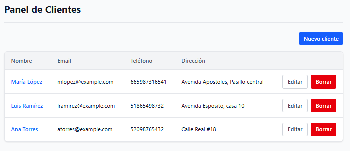

# Client Panel

A small full-stack CRUD app to manage clients: a **React + TypeScript** frontend talking to a **Go REST API** backed by **PostgreSQL**, all runnable with a single `docker compose up`.




## Features

- List, create, edit and delete clients
- Separate screens with client-side routing: list, detail, new, edit
- Form validation in the browser (and again in the API)
- Loading and error states
- Component and form tests with Vitest + Testing Library

## Architecture

```
Browser ──► NGINX (:3000) ──► serves the React build (static files)
                │
                └── /api/*  ──► Go API (:8082, internal) ──► PostgreSQL (:5432, internal)
```

- **Frontend** (`frontend/`): Vite + React + TypeScript (strict), React Router, Tailwind CSS, plain `fetch`.
- **Backend** (`backend/`): Go standard library (`net/http`) + `pgx`. Four small files, no framework and no layered architecture: `main.go` (routes, CORS), `handlers.go`, `store.go` (SQL), `client.go` (model and validation).
- **Database:** PostgreSQL 17, the `clients` table is created on API startup.
- **Single origin:** NGINX forwards `/api` to the Go service, so the browser only talks to one origin. In development, Vite's dev-server proxy does the same.

### API

| Method | Path | Description |
|---|---|---|
| GET | `/api/clients` | List clients |
| POST | `/api/clients` | Create a client |
| GET | `/api/clients/{id}` | Get one client |
| PUT | `/api/clients/{id}` | Update a client |
| DELETE | `/api/clients/{id}` | Delete a client |

Errors are returned as `{"error": "message"}` with a 400, 404 or 500 status.

### Frontend structure

```
frontend/src/
  main.tsx                    entry point, wraps the app in BrowserRouter
  App.tsx                     header and routes
  api/clients.ts              typed functions for the 5 API calls
  pages/                      one component per route (list, form, detail)
  ClientTable.tsx, ClientForm.tsx   presentational / controlled-form components
  types.ts, ui.ts             shared types and button styles
```

## Run it

Requires Docker.

```bash
cp .env.example .env      # then set a password in .env
docker compose up --build
```

Open <http://localhost:3000>.

### Development without Docker for the app

```bash
docker compose up -d db          # PostgreSQL on localhost:5433
cd backend && go run .           # API on :8082
cd frontend && npm install && npm run dev   # http://localhost:5173
```

### Tests

```bash
cd frontend && npm test
```

Three tests: the list renders clients, the list shows an error when the API fails, and the form submits the typed data. The API module is mocked, so no backend is needed.

## What I learned / level

I am a backend engineer (Go, PostgreSQL, microservices). This is my **first React project**, built as a learning exercise, and my React level is **basic**. Before this my frontend experience was informal HTML/CSS/JS.

What I practised here: components and props, `useState` / `useEffect`, controlled forms, lists and `key`, React Router, typing API responses with TypeScript, Tailwind, testing with Testing Library, and containerising a frontend with NGINX.

What I have **not** done yet: authentication, pagination and search, global state management or a data-fetching library, accessibility audits, or end-to-end tests.

I used an AI assistant as a tutor while building it, and I went through the code line by line to be able to explain and fix it.
